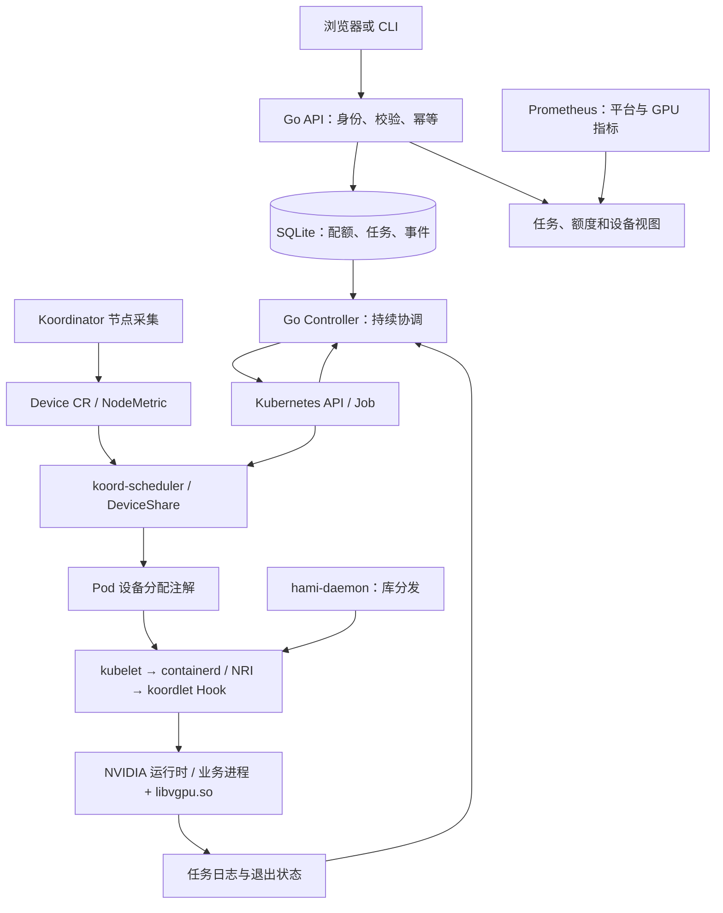

# GPU Workbench：Koordinator + HAMi-core 资源工作台设计稿

状态：用户已批准并要求本机部署；已实现源码并增加 k8s-sim 模式。当前无 NVIDIA 节点，真实 GPU 隔离尚未验证。实现记录见 progress.md。

## 1. 目标与实际用途

面向共享少量 NVIDIA GPU 的小团队，将任务提交、团队配额、Kubernetes Job、GPU 分配结果、任务日志、运行指标和失败回收放在一个工作台中。

用户从零学习，目标是亲手运行、修改、排障并解释完整链路。教会用户是明确交付目标；完成讲解不等于已经掌握。本项目记录为个人实战。

首个真实用途：多个团队提交 GPU 矩阵计算或离线批处理任务，分别申请显存与计算资源预算；平台限制团队总申请额度，Koordinator 执行设备选择和分配，HAMi-core 执行容器内 GPU 资源限制。用户能看到任务为何等待、分配到哪里、运行多久、取消后何时释放。

配套部署在线计算服务与离线批任务，测量共享 GPU 和 CPU/内存混部造成的干扰。这些是有明确工作量的计算负载；没有部署真实模型时不称为模型推理。

成功标准：任务能真正被创建、运行、观察、取消和回收；进程重启及 API 请求不确定时不重复创建任务、不提前释放额度；实验有原始结果和明确的适用范围。

所有材料和最终源码均保存于本目录，不修改既有学习材料或源码目录。

## 2. 已知环境与假设

- 本机为 macOS amd64，已确认 Go 1.27.2 可执行。
- kubectl 文件存在；客户端版本命令未及时返回，尚未确认它可用。
- 当前 PATH 未找到 Docker、kind、Helm。尚未安装任何依赖。
- 用户提供了某节点的 HAMi NVIDIA 注册注解，记录包含 Tesla P4、7680 MiB、Count=1。它不能证明容器已加载 HAMi-core，也不能证明有独立测试集群。
- 可部署集群、GPU 使用权限和容器镜像仓库仍待确认。默认只生成部署产物，不操作现有业务集群。
- 第一版使用 NVIDIA 设备路径；P4 可作为候选验证设备，但示例负载、CUDA、驱动与镜像组合需单独检查兼容性。显存预算采用 MiB。
- 集成采用 containerd NRI 路线。官方文档要求 containerd >= 1.7 且启用 NRI，Koordinator >= 1.7。初始候选为 Koordinator 1.8.0、hami-daemon Chart 0.1.0 与其 HAMi-core v2.6.0；这是文档支持的候选组合，不是已经完成实测的版本矩阵。
- 当前任务明确排除 Volcano；Koordinator 与 HAMi-core 都属于首版核心组件。

## 3. 方案比较与选择

| 方案 | 优点 | 代价 | 选择 |
|---|---|---|---|
| GPU 资源工作台，复用 Koordinator 与 HAMi-core | 小范围内形成真实共享与混部闭环，Go 业务与调度机制都能学习 | 需要实现可靠的异步控制流程和集成检查 | 采用 |
| 从头写 GPU 调度器、Device Plugin 与隔离库 | 底层范围广 | 三套核心系统，难以在合理范围内验证正确性 | 不作为首版 |
| 单纯部署多个开源项目并展示看板 | 启动快 | 自己编写的业务逻辑和故障恢复链路不足 | 作为实验环境配套 |

## 4. 系统边界

第一版自研：HTTP API、轻量 Web 页面、团队配额账本、任务持久化、Kubernetes Job 控制循环、日志查询、事件记录、指标导出和实验脚本。

复用：koord-scheduler 的 DeviceShare 设备调度、Koordinator 节点采集和资源管理、koordlet 的 GPU Runtime Hook、containerd NRI、NVIDIA 容器运行时、HAMi-core 的 NVIDIA 共享限制、Kubernetes Job 的执行管理、Prometheus 的指标存储。

部署 HAMi 的节点侧 hami-daemon（库分发及 vGPUmonitor）。本方案的业务 Pod 只由 koord-scheduler 调度，不部署独立的 HAMi Scheduler/Extender。新测试环境仅配置一条经过验证的 GPU 分配与设备交付路径，不能让不同资源名称背后各自的分配器独立使用同一组 GPU。

严格区分三个账本：

1. 团队配额：限制通过本平台提交的任务总申请量，不代表集群物理剩余资源。
2. 设备分配：由实际调度与设备组件管理，本平台只读取并展示分配结果。
3. 实际使用：由设备监控及任务测量获取，缺失时显示未知，不用申请值填充。

平台不提前选择 GPU UUID，不设置 Pod nodeName 绕过调度，不直接修改 scheduling.koordinator.sh/device-allocated。设备调度缓存和资源预留由 Koordinator 管理。

首版不承诺集群级多租户安全隔离、所有厂商兼容、在线 SLA、GPU 进程热迁移或计费准确性。

## 5. 架构与组件

技术栈：Go、client-go、SQLite、原生 HTML/CSS/JavaScript、Kubernetes YAML/Kustomize、Prometheus。第一版使用单个控制服务进程，避免不必要的分布式服务拆分。

部署为单副本 StatefulSet，SQLite 数据放在持久卷中；数据库事务与唯一约束负责并发提交一致性。不支持多个独立写入服务，也不把节点本地数据库宣称为高可用系统。后续需要多副本时才引入共享数据库和领导者选举。

提供进程互斥与数据库锁配置；第二个服务实例不能同时取得执行权。SQLite 放在支持其锁语义的本地或块存储文件系统，不使用未经验证的网络共享文件系统。

## 6. 三种运行模式

| 模式 | 运行方式 | 能验证 | 不能验证 |
|---|---|---|---|
| k8s-sim | 本机 Linux VM，真实 Kubernetes / Koordinator，模拟 Device CR 与隔离账本 | 调度、共享、碎片、健康状态、Job 生命周期和恢复 | 真实 GPU 性能、CUDA 拦截与硬件隔离 |
| local-demo | Go 单进程、本地 SQLite、确定性的虚拟执行后端 | API、配额、幂等、状态转换、重启恢复与故障演练 | Kubernetes 调度、真实 GPU 性能与隔离 |
| k8s-cpu | 同一服务连接测试集群，创建真实 CPU Job | RBAC、Job 生命周期、事件、日志、取消及恢复 | GPU 共享与设备注入 |
| k8s-koord-hami | 服务连接已配置 Koordinator + HAMi-core 的独立 GPU 测试集群 | 真正的 GPU 申请、分配、共享、运行与回收；混部对照实验 | 未安装设备或未测试版本的能力 |

页面顶部、API 响应、指标和实验报告均携带模式标记。演练数据和实测数据不可合并为同一结果。

第一版交付固定依赖与镜像版本文件。具体 Kubernetes、Koordinator、HAMi-core、containerd、NVIDIA Runtime、CUDA 和工作负载镜像组合在实现阶段根据可用环境核对，并分别记录“目标支持”和“实际验证”。不自动升级现有集群。

## 7. 一条完整用户流程

1. 管理员配置 alpha、beta 两个学习团队的配额和令牌。
2. 团队提交任务：名称、负载模板、显存 MiB、core 百分比、执行时长及普通/BE 负载类别。首版每任务一个业务容器、申请一张卡上的一份共享资源。
3. API 校验请求，在单个事务中写入任务和团队配额占用。
4. Controller 使用确定性的任务标识创建 Kubernetes Job；创建失败按错误类别重试或进入清理流程。
5. koord-scheduler 选择节点与设备，并将分配结果写入 Pod 注解。控制台显示排队原因、分配结果、Pod 状态和事件。
6. kubelet 经容器运行时创建容器，koordlet NRI Hook 注入 GPU 配置，HAMi-core 在业务进程中加载；用户查看日志、运行时间和可用 GPU 指标。
7. 正常结束或用户取消后，平台等待实际执行停止，再释放团队配额。
8. 留存任务记录、状态变化及基准结果；后续重启不重复创建已结束的工作负载。

首版仅允许内置、受控参数的工作负载模板；不开放任意镜像、宿主机挂载或 privileged Pod。

## 8. 数据模型与 API

### 数据模型

- Team：id、令牌摘要、启用状态、max_active_tasks、max_gpu_units、max_memory_mib、max_core_units。
- Task：id、team_id、幂等键、规范化请求摘要、模式、负载参数、期望状态、观察状态、资源预算、namespace、job_name、job_uid、时间戳和错误原因。
- Reservation：task_id 唯一、team_id、gpu_units、memory_mib、core_units、释放时间。
- Event：递增 id、task_id、时间、类型、原因、消息。

资源计算：首版 gpu_count 固定为 1，memory_mib 为此任务请求的显存 MiB，core_units 为请求的计算百分比。每张 GPU 的 100 表示其预算刻度，不代表不同 GPU 型号具有等价吞吐。多卡参数在首版直接拒绝，不将单卡注入逻辑外推到多卡。

### API

- POST /api/tasks：需 Idempotency-Key，返回任务与状态。
- GET /api/tasks：列出当前团队任务，分页。
- GET /api/tasks/{id}：任务状态、原因与实际分配。
- POST /api/tasks/{id}/cancel：幂等取消。
- GET /api/tasks/{id}/events：平台事件与脱敏后的 Kubernetes 事件。
- GET /api/tasks/{id}/logs：有大小上限的任务日志。
- GET /api/quota：团队配额与已预留额度。
- GET /api/devices：管理员查看 Koordinator Device CR、设备健康、分配信息与观察更新时间；可另显示现有 HAMi 注解作为诊断数据，但不将其用作本方案资源账本。
- GET /metrics、/healthz、/readyz：平台指标与健康检查。

同一团队同一幂等键和相同请求返回原任务；不同请求使用同一个键返回 409。额度不足返回 409，参数错误返回 400，未认证返回 401，无权访问返回 403。

团队身份来自令牌，不相信请求体中的 team_id。公开入口默认不开启；本地模式只监听回环地址，集群模式默认 ClusterIP。

## 9. 状态、故障与资源释放

状态：Queued → Submitting → Pending → Running → Succeeded / Failed。

任何非终态均可进入 Cancelling → Cancelled；发生需要清理的异常时先进入 Cleaning，清理完成后再进入 Failed。

基本不变量：任意非终态任务都保留配额占用；任务只有一个活动 reservation；reservation 释放必须有任务终止或执行对象不存在的可靠证据。

关键处理：

- 并发提交：在数据库事务中检查团队总占用并创建 reservation，禁止先读后写的无保护累计。
- 创建 Job 超时：保持配额，按确定性名称 GET 对账；发现对象时核对 owner 标记、请求摘要和 UID，不直接重建或释放。
- 控制服务重启：读取未终结任务并与集群对账，禁止仅根据内存状态恢复。
- 删除任务：先记录取消意图，禁止后续重建；暂停 Job 并观察关联 Pod，保留暂停对象作为取消标记。API 不可达时保持 Cancelling 和配额。
- 失败或超时：先停止实际执行，再释放；墙上时钟的租约超时本身不构成释放依据。
- Job 已删除但 Pod 仍运行：维持配额，继续清理和对账。
- 工作负载终止：Job 状态和关联 Pod 状态共同判定，兼顾不同 Kubernetes 版本的终态时序。
- 集群 API 不可达：显示状态未知或观察过期，保留最后观察值，不能将未知当成空闲。
- SQLite 写入失败：API 不确认创建成功，Controller 停止产生新的外部执行动作并报告就绪失败。

工作负载 Job 默认 backoffLimit=0，避免任务执行失败后自动消耗额外 GPU 时间；用户通过新任务显式重跑。设置 activeDeadlineSeconds，并保留终态记录直到实验结果采集完成。

## 10. Koordinator + HAMi-core 接入约定

### 部署与设备数据流

1. Koordinator 节点侧组件采集设备，形成 Device CR；koord-manager 同步共享资源，供调度使用。采集组件的具体名称以锁定版本为准。
2. 显式检查 koordlet 的 GPUEnvInject=true 与 koord-manager 的 EnableSyncGPUSharedResource=true；只设置已核实的开关，禁止用 AllAlpha 替代。
3. containerd 启用 NRI 并允许 koordlet 注册 Hook；NVIDIA 容器运行时负责设备和驱动访问能力。安装后必须有一个能调用 CUDA 的最小验证任务。
4. hami-daemon 在目标 GPU 节点部署 libvgpu.so 和可选监控服务。确认文件与库版本后，再设置节点 koordinator.sh/gpu-isolation-provider=HAMi-core 标签。
5. 业务 Pod 指定 schedulerName: koord-scheduler，并带相同的 gpu-isolation-provider 标签。字段属于 Job 的 spec.template，不能只写到 Job metadata。
6. koord-scheduler 写入 scheduling.koordinator.sh/device-allocated；koordlet Hook 读取注解，按条件注入设备可见性、限制环境变量和库挂载。

### 请求与分配协议

- 单卡共享请求使用 koordinator.sh/gpu.shared: 1、koordinator.sh/gpu-core 和 koordinator.sh/gpu-memory；requests 与 limits 保持一致。MiB 在 Kubernetes 资源量中表示为如 1024Mi，不能沿用 HAMi 独立方案 gpumem 的裸整数约定。
- 固定比例示例可使用 koordinator.sh/gpu-memory-ratio: 25；绝对显存模式和比例模式分别测试，第一版 API 只暴露绝对显存模式，禁止混合提交。
- 第一版共享实验限定每任务一份、一个业务容器，目标预算小于整卡显存。多卡与多业务容器将在验证注入语义后再扩展。
- 最终分配以 Pod 的 device-allocated 注解为准，按资源 Quantity 解析，不用字符串截取或原始申请值代替设备分配。
- 设备展示来自 Device CR，保留原始值、解析结果和来源时间；数据过期时显示未知。
- 本地 gpu.go 的 HAMi-core 分支在显存比例 < 100 时注入限制，且读取 devices[0]。因此不把带标签、整卡申请或多卡申请直接判定为隔离已生效；发布版本也要逐条复核。
- 验收须检查容器内配置、实际 GPU 进程 /proc/PID/maps 和受控超限实验。出现分配注解只算“已分配”，不能算“已隔离”。

### 混部配置与实验

- 在线计算服务采用 LS/koord-prod，离线任务采用 BE/koord-batch；仅作用于 gpu-workbench 实验命名空间及带本项目标记的 Pod。
- 使用目标版本支持的 ClusterColocationProfile 配置资源模型和 QoS 注入，并检查实际创建后的 Pod；默认空 selector 不用于实验配置，防止匹配整个集群。
- BE 的 CPU/内存回收与保护属于 Koordinator 主机资源治理；同卡 GPU 上的显存约束和计算干扰单独测量。设置 LS 标签本身不是 GPU P99 保证。
- 第一组实验保持 GPU 资源配置不变，只改变 CPU/内存混部策略；第二组保持主机配置不变，只改变 GPU 并发和共享预算。
- 检查 cgroup 版本、内核与相关 QoS 开关。环境不支持某项策略时报告跳过及原因，不展示虚构收益。

## 11. 可观测性与效果对比

平台导出：按状态任务数、提交与取消次数、创建 API 错误、重试次数、对账耗时、排队与运行时长、团队预留预算。

GPU 实测指标由 hami-daemon 中的 vGPUmonitor 或匹配版本的设备监控提供；CPU/内存指标由 Koordinator 和工作负载提供。指标源没有返回的数据标记缺失，不回退为演练值。

不把 task_id、Pod UUID、日志文本作为持续增长的 Prometheus 标签。任务级细节保存在数据库和事件中；团队标签由固定配置控制规模。

对比实验固定负载、并发和硬件，记录运行模式、软件版本、参数、样本量、失败次数和原始日志。比较吞吐、任务完成时间、等待时间及单卡并发数；只有业务指标满足约束时才评价收益。

## 12. 验收实验

| 实验 | 操作 | 必须观察到的结果 | 环境 |
|---|---|---|---|
| 并发配额 | 同时提交超过团队额度的任务 | 接受总预算不超限，失败请求不占额度 | local-demo / 集成测试 |
| 幂等提交 | 重复发送同一请求，改变请求后复用键 | 一个任务、一个 reservation；冲突返回 409 | 全部 |
| 创建结果不确定 | 后端成功后模拟客户端超时 | 对账找到原对象，不重复创建，不释放额度 | 自动化注入 / k8s-cpu |
| 服务重启 | 活跃任务期间重启控制服务 | 恢复状态、额度不丢失、执行对象不增加 | 全部 |
| 取消与删除延迟 | 保持关联 Pod 存活或 API 暂时失败 | 保持 Cancelling，确认停止后才释放 | 集成测试 / k8s-cpu |
| 设备注册 | 读取 Device CR 与 device-allocated | 解释注册、预算和实际使用的区别 | k8s-koord-hami |
| 集成链验证 | 提交单卡小显存任务，检查分配、注入与进程映射 | 确认由 koord-scheduler 分配，并由 HAMi-core 加载限制 | k8s-koord-hami |
| GPU 共享 | 单任务与两个小任务共享对比 | 记录真实吞吐、显存和完成时间，不预设提升 | k8s-koord-hami |
| 资源限制 | 小范围请求超出分配预算 | 记录调用结果和邻居负载变化；支持报告未生效 | k8s-koord-hami |
| GPU 碎片 | 两卡小任务放置后提交大任务 | 分析每张卡余量及 Koordinator DeviceShare 放置策略 | 至少两张卡；本地只作算法演练 |
| 主机混部 | 在线计算服务与 BE 压力任务同节点运行 | 对比 CPU/内存压力、回收行为、在线 P99 与吞吐 | 支持所选策略的 Linux 测试节点 |
| GPU 干扰 | 在线 GPU 计算与离线 GPU 任务同卡运行 | 独立记录 GPU 共享引起的延迟变化，不与主机保护混为一谈 | k8s-koord-hami |

第一版测试覆盖额度并发、幂等、状态机、API 故障、进程重启和任务归属校验。验证命令包括 go test、go test -race、go vet、部署清单校验以及可用环境中的端到端测试。

没有实际执行的 GPU 验收必须标记“未验证”，不能算作通过。

## 13. 教学交付

每课流程：运行一个现象 → 画出调用链 → 阅读关键代码 → 修改一个行为 → 注入一个故障 → 用户复述与变式检验。

1. 一次提交如何成为任务：HTTP、身份与数据模型。
2. 为什么并发会超卖：事务、幂等键与额度账本。
3. Controller 为什么反复检查：期望状态、观察状态与幂等协调。
4. Job 如何获得 GPU：Device CR、DeviceShare 调度、分配注解、NRI Hook 与容器注入。
5. 为什么调度成功不代表隔离有效：真实进程检查与预算实验。
6. 如何从故障恢复：不确定的创建、取消、删除与重启。
7. 如何证明有价值：监控、基线、对照组与结果边界。
8. 在线离线混部：QoS、优先级、batch 资源、主机保护与 GPU 干扰的区别。

源码、中文 README、API 示例、容器构建文件、三种模式配置、部署清单、实验脚本、逐课 HTML、运行结果目录与证据清单作为实现阶段的交付物。没有对应源码和验证结果的功能不标记完成。

## 14. 实现顺序与边界

1. 交付 Koordinator + hami-daemon 的版本配置、环境检查、单卡验证负载和结果采集脚本。先验证集成，再增加管理功能。
2. 交付 Go API、SQLite 配额与幂等、任务 Controller、Kubernetes Job 和本地演练后端。
3. 交付设备/分配/使用视图、日志和事件、Prometheus 配置、故障与回收实验。
4. 交付在线计算服务、离线批任务与混部对照实验。
5. 每部分配套源码导航、逐课讲义和变式任务；用户运行、修改、复述后记录学习结果。

多机训练、其他调度器、DRA、其他厂商适配暂不纳入当前交付。后续是否扩展由用户决定。

## 15. 官方依据

- Koordinator 安装：https://koordinator.sh/docs/installation
- Koordinator 与 HAMi-core：https://koordinator.sh/docs/user-manuals/device-scheduling-gpu-share-with-hami
- 混部配置：https://koordinator.sh/docs/user-manuals/colocation-profile
- containerd NRI：https://github.com/containerd/containerd/blob/main/docs/NRI.md
- HAMi 生态分工：https://project-hami.io/docs/core-concepts/ecosystem-integrations
- Kubernetes Job：https://kubernetes.io/docs/concepts/workloads/controllers/job/

本地源码线索（源码快照，不等同于生产版本）：

- koordinator-main/apis/extension/device_share.go：GPU 资源名、隔离标签与分配注解。
- koordinator-main/pkg/koordlet/runtimehooks/hooks/gpu/gpu.go：设备可见性、HAMi-core 环境变量与挂载注入。
- koordinator-main/pkg/scheduler/plugins/deviceshare/：设备分配与评分。
- koordinator-main/pkg/features/features.go：共享资源同步开关。

## 16. 当前检查记录

- 已检查现有教学使命，项目范围与之相符。
- 已按用户最新要求将 Koordinator + HAMi-core 提升为首版必需主线，并排除其他调度器扩展。
- 已将请求协议、设备数据源和注入链路一并修订，不再沿用 HAMi 独立调度方案的协议。
- 已区分团队预算、设备分配和实际使用，避免重复分配。
- 已规定创建结果不确定、取消中、重启和 API 不可用时的处理。
- 已区分本地演练、CPU 集群验证和 GPU 实测。
- 环境问题已向用户提出，当前没有据此安装或操作任何集群。
- 当前成果只有设计稿；产品代码、部署和学习验收仍待执行。
